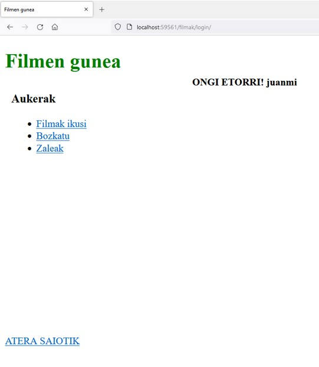
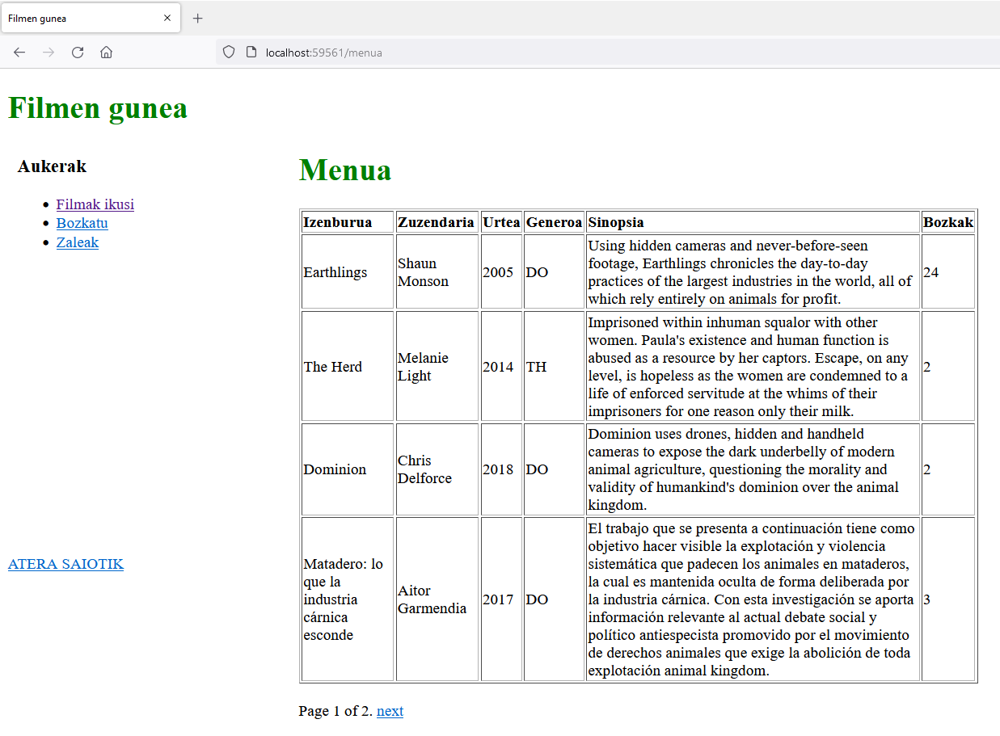
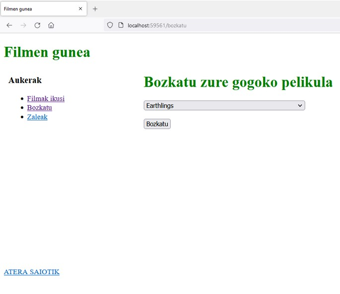
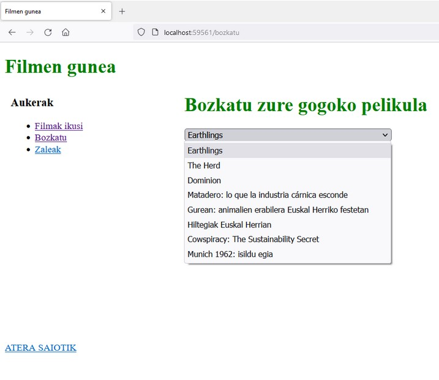
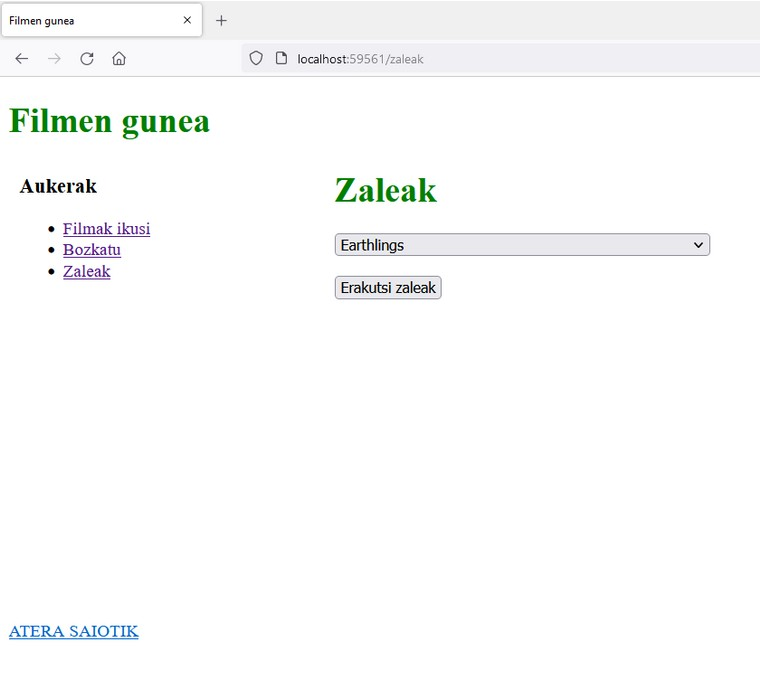
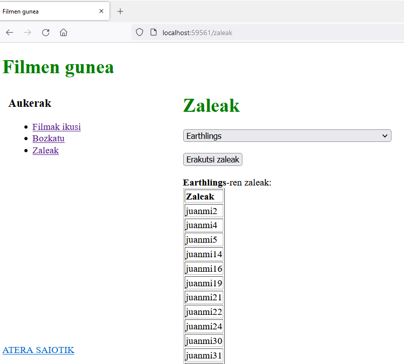
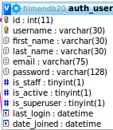
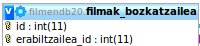
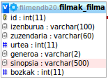

> **<u>HERRAMIENTAS AVANZADAS DE DESARROLLO DE SOFTWARE</u>**
>
> **LABORATORIO** **4.** **DJANGO** **(2025-2026**)

**OBJETIVOS**

> Conocer la plataforma Django y aprender a utilizarla.

**MATERIAL** **Y** **CONTENIDO** **A** **SUBIR**

Encontrarás este enunciado en el eGela de la asignatura. Al final de
este documento tienes, entre otros, el apartado a rellenar para realizar
el resumen de lo realizado en la sesión de laboratorio.

El plazo para subirlo está especificado en la tarea correspondiente en
eGela.

<u>Se debe entregar en eGela este mismo documento (con el resumen de lo
realizado</u>

<u>cumplimentado).</u> El nombre del fichero debe tener el siguente
formato (todo en minúsculas): ***LAB04_Gx.pdf***

En el *<u>repositorio</u>* se incluirán los siguientes documentos:

1\) el proyecto django íntegro, con todos los ficheros con código fuente
y el resto de ficheros (BD con el modelo, ficheros del proyecto (sln,
etc.), y demás ficheros incluidos dentro de la carpeta generada en el
proyecto);

**EJERCICIO.** **SITIO** **WEB** **DE** **LOS** **FILMS.**

Esta práctica consiste en desarrollar un sitio web llamado “sitio de
films”, utilizando la plataforma Django. Se basa en la gestión de
películas y usuarios.

Nota: El sitio web puede contener la sección admin, pero es opcional.

El sitio web tiene dos partes principales:

> Gestión de usuarios
>
> Gestión de films

Estos dos apartados están relacionados y para poder utilizar las
opciones del apartado de películas se exigirá que los usuarios estén
registrados.

> **CASO** **DE** **USO:** **<u>SECCIÓN USUARIOS</u>**
>
> 1\. Registrarse:
>
> Se permitirá la inscripción y registro en la zona de películas.
>
> Se solicitará el nombre de usuario y la contraseña al registrarse. Una
> vez registrado, el usuario podrá acceder al sistema.
>
> 2\. Entrar (login):
>
> El usuario deberá introducir correctamente su nombre y contraseña, en
> caso contrario no se le permitirá la entrada.
>
> Si los datos son inexactos, se comunicará al usuario. Una vez
> introducido, el usuario inicia una sesión.
>
> Se permitirá el uso de la sección de películas cuando el acceso sea
> correcto. Los usuarios que no accedan no podrán acceder a la
> información de las películas.
>
> 3\. Salir (logout):
>
> El usuario finaliza la sesión.

**<u>NOTA</u>**: Emplead los formularios de Django, de forma que no
tengáis que programar las acciones como hacíais en laboratorios previos

**CASO** **DE** **USO:** **<u>SECCIÓN FILMS</u>**

El usuario logueado, en este menú, tendrá la oportunidad de ver algunas
informaciones sobre las películas, qué películas le gustan y a qué
usuarios les gusta una película.

> 4\. Ver Films
>
> La información sobre las películas se mostrará en una tabla
>
> Características que se mostrarán: título, director, año, género,
> sinopsis, votos
>
> 5\. Votar Films
>
>  style="width:2.28542in;height:1.97222in" /> style="width:2.39514in;height:2.07639in" /> El usuario seleccionará y
> votará sus películas favoritas. Una película sólo se podrá votar una
> vez por el usuario.

6. Ver que usuarios ha votado
una película

> Se mostrará quién ha votado una película

7. La base de datos de los
films tendrá el siguiente aspecto:

> (1,N)
>
> gogoko\_ filmak
>
> (1,M)
>
> (1,1) (1:1)

erabiltzailea

> (1,1)

**NOTA**: los nombres de los atributos se pueden poner en castellano o
inglés siempre y cuando se mantengan tanto el número como el tipo de
cada uno de ellos.

**8.** **Oharrak:**

> Para el registro y login del usuario se pueden utilizar los recursos
> que ofrece el propio Django
>
> User es un modelo, y el otro sería Votante.
>
> Cuando un usuario vote, entonces se convertirá en Votante.
>
> Si se quieren recoger los elementos que se han seleccionado en una
> lista select, se puede utilizar una expresión como:
>
> request.POST.getlist ('opciones'), donde la opción es el nombre del
> elemento select.
>
> Para la información de las películas podéis utilizar los siguientes
> datos:

f1 = Filma(izenburua="Earthlings", zuzendaria="Shaun Monson",
urtea="2005", generoa="DO", sinopsia="Using hidden cameras and
never-before-seen footage, Earthlings chronicles the day-

to-day practices of the largest industries in the world, all of which
rely entirely on animals for profit.", bozkak="0")

f2 = Filma(izenburua="The Herd", zuzendaria="Melanie Light",
urtea="2014", generoa="TH", sinopsia="Imprisoned within inhuman squalor
with other women. Paula's existence and human function is abused as a
resource by her captors. Escape, on any level, is hopeless as the women
are condemned to a life of enforced servitude at the whims of their
imprisoners for one reason only - their milk.", bozkak="0")

f3 = Filma(izenburua="Dominion", zuzendaria="Chris Delforce",
urtea="2018", generoa="DO", sinopsia="Dominion uses drones, hidden and
handheld cameras to expose the dark underbelly of modern animal
agriculture, questioning the morality and validity of humankind's
dominion over the animal kingdom. ", bozkak="0")

f4 = Filma(izenburua="Matadero: lo que la industria cárnica esconde",
zuzendaria="Aitor Garmendia", urtea="2017", generoa="DO", sinopsia="El
trabajo que se presenta a continuación tiene como objetivo hacer visible
la explotación y violencia sistemática que padecen los animales en
mataderos, la cual es mantenida oculta de forma deliberada por la
industria cárnica. Con esta investigación se aporta información
relevante al actual debate social y político antiespecista promovido por
el movimiento de derechos animales que exige la abolición de toda
explotación animal. ", bozkak="0")

f5 = Filma(izenburua="Gurean: animalien erabilera Euskal Herriko
festetan", zuzendaria="Linas Korta", urtea="2018", generoa="DO",
sinopsia="Askekintzak Euskal Herriko festetako animalien erabileraren
inguruan inoiz egin den dokumentazio lan handiena bildu du. Gurean, 4
urteetan zehar (2014-2017) aktibista desberdinek ezkutuan grabatutako
irudiekin osatutako dokumentala da.", bozkak="0")

f6 = Filma(izenburua="Hiltegiak Euskal Herrian", zuzendaria="Nor",
urtea="2018", generoa="DO", sinopsia="Azken minutua: Heriotza eta
erresistentzia. 3 urteetan zehar Euskal Herriko edo inguruetako
hiltegietan grabatutako irudiak dira honakoak.", bozkak="0")

f7 = Filma(izenburua="Cowspiracy: The Sustainability Secret",
zuzendaria="Kip Andersen eta Keegan Kuhn", urtea="2014", generoa="DO",
sinopsia="Follow the shocking, yet humorous, journey of an aspiring
environmentalist, as he daringly seeks to find the real solution to the
most pressing environmental issues and true path to sustainability.",
bozkak="0")

f8 = Filma(izenburua="Munich 1962: isildu egia", zuzendaria="Larraitz
Ariznabarreta eta Naroa Anabitarte", urtea="2014", generoa="DO",
sinopsia="Kezka batetik sortutako proiektua da Munich 1962: isildu egia.
Ordu hartan Munichen egon zirenen hitzak jaso dituzte Orreaga Taldeko
kideek. Dokumental historikoa izateaz harago doa, ikus-entzulea
hausnarketara gonbidatu nahi du. 'Iruditzen zaigu oraindik ere orduan
gertatutakoak gaurkotasun handia duela; oraindik berdin jarraitzen dugu,
garai hartan egin ziren akats berberak errepikatzen dira gaur egun',
Naroa Anabitarte (Tolosa, 1979) Orreaga Taldeko kide eta dokumentalaren
egilearen esanetan. Ez du ikusten politikarien aldetik akats berak ez
errepikatzeko nahirik, 'ematen du dinamika beretan jarraitu nahi dela,
aldez aurretik galduak diren bideak erabiliz'.", bozkak="0")

**<u>RESUMEN DEL TRABAJO REALIZADO</u>**

1\. Hasta dónde has llegado:

> \- Realizada la 1ª parte, Registro (sí/no): - Realizada la 2ª parte,
> Login (sí/no):
>
> \- Realizada la 3ª parte, Logout (sí/no):
>
> \- Realizada la 4ª parte, Ver películas (sí/no):
>
> \- Realizada la 5ª parte, Votar películas (sí/no): - Realizada la 6º
> parte, Aficionados (sí/no):

2\. Posibles ejercicios optativos:

> \- **Versión** **de** **Django**. Crea tu aplicación Django con una
> versión de la librería Django que sea, como mínimo, la 3.0. Asegúrate
> de que funciona correctamente con el entorno virtual Python. Entrega
> un documento Word describiendo el proceso, introduciendo imágenes de
> pantalla del proceso seguido y especificando los tutoriales que has
> utilizado, así como especificando la versión de Django con la que has
> desarrollado tu aplicación.
>
> \- **Internalización**. Adapta tu aplicación Django para estar
> adaptada de forma adecuada al menos a dos países diferentes. Para
> ello, puedes cambiar el idioma cambiando a través de un enlace el
> idioma que aparece en los elementos gráficos de la interfaz. Si lo
> consigues hacer, entrega un documento Word describiendo el proceso,
> introduciendo imágenes de pantalla del proceso seguido y especificando
> los tutoriales que has utilizado.
>
> \- **“Mejorar”** la interfaz gráfica de usuario. Hacer más atractiva
> la interfaz gráfica de usuario gestionando correctamente las hojas de
> estilo y el contenido estático (static) de Django. Si lo consigues
> hacer, entrega un documento Word describiendo el proceso,
> introduciendo imágenes de pantalla del proceso seguido y especificando
> los tutoriales que has utilizado.
>
> \- **Extiende** tu aplicación web Django a **Azure**. Si quieres
> puedes: 1) subir la BD sqlite a Azure; 2) cambiar el sistema de
> gestión de bases de datos de sqlite a SQL Server, borrar el Dba que
> tenías en Azure y crear otro. Si lo consigues hacer, entrega un
> documento Word describiendo el proceso, introduciendo imágenes de
> pantalla del proceso seguido (al estilo de las transparencias de
> difusión Azure de la asignatura) y especificando los tutoriales que
> has utilizado. Si has hecho un despliegue, especifica el enlace de
> Azure para acceder a tu aplicación web.

4\. Además del código del laboratorio, debéis entregar un **video**
**demo** que muestre cómo funciona vuestro sistema, similar al que os he
subido en eGela. El vídeo demo entregadlo en un fichero con **formato**
**de** **fichero** **de** **vídeo** (**.avi,** **.mp4,** **.mkv**, etc.)

5\. Indica aquí la opinión general sobre la sesión de laboratorio, los
problemas encontrados, qué se puede mejorar, qué quitarías, por qué,
etc. Tranquilidad que lo incluido en la opinión general no restará nota
(tampoco la subirá).
